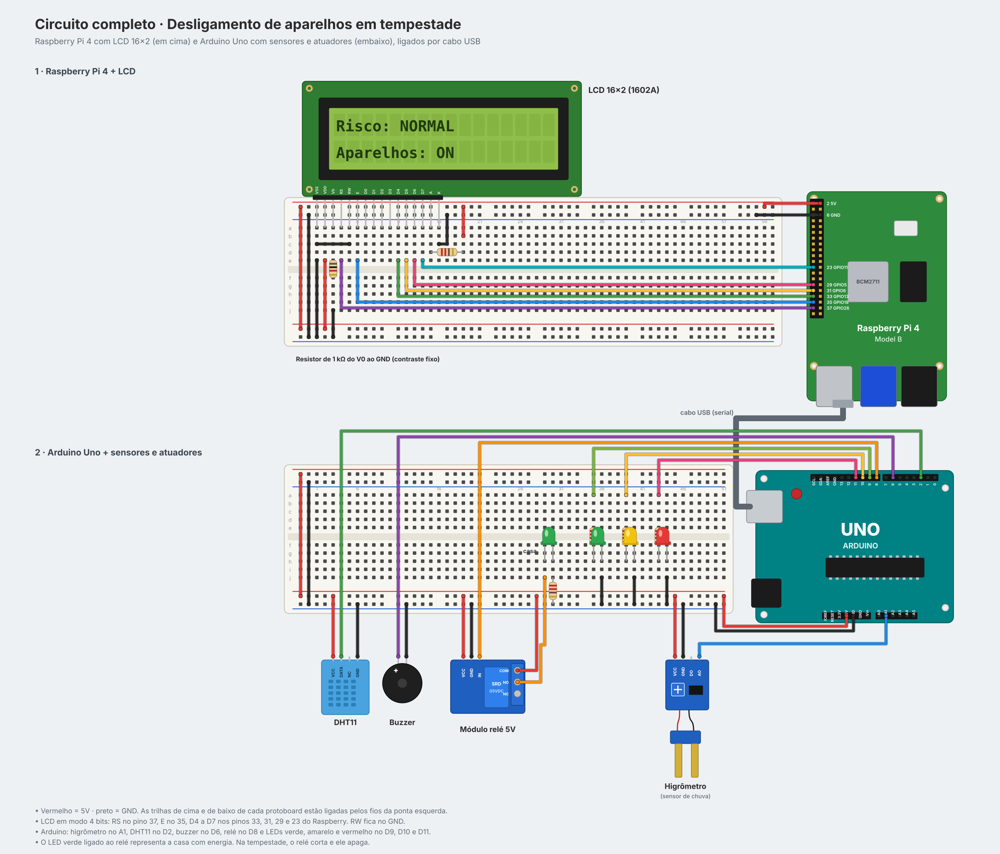

# Trabalho Final - Hardware Architecture

Desligamento de aparelhos em tempestade com Arduino e Raspberry Pi 4. Projeto final da disciplina de Hardware Architecture, Ciência da Computação, Atitus.

O Arduino lê temperatura e umidade (DHT11) e chuva (higrômetro) e manda os dados por USB serial para o Raspberry Pi. O Raspberry calcula o nível de risco, grava as leituras em SQLite, mostra o estado no LCD 16x2 e no site em Flask, e manda o Arduino desligar o relé quando chega tempestade. Um LED verde ligado ao relé representa a casa com energia.

## Equipe

- Luiz Eduardo Treméa (líder)
- Bruno Benetti
- Patrick Marques

A divisão das tarefas está em [docs/divisao-tarefas.md](docs/divisao-tarefas.md).

## Estrutura

| Pasta | Conteúdo |
| --- | --- |
| `arduino/` | Firmware do Arduino Uno |
| `raspberry/` | Coletor, regra de risco, LCD, banco, site e testes |
| `wokwi/` | Simulação do circuito do Arduino |
| `docs/` | Diagrama, pinagem e divisão de tarefas |

## Regra de risco

| Sinal | Pontos |
| --- | --- |
| Umidade subiu e temperatura caiu | 1 |
| Chuva detectada | 2 |

Com 0 ou 1 ponto, o nível é normal. Só chuva dá 2 pontos: atenção. Chuva com umidade subindo dá 3: tempestade, o relé corta a energia da casa, o LED vermelho acende e o buzzer toca. A energia volta sozinha depois de um tempo em nível normal.

## Simulação

O circuito do Arduino está no Wokwi: https://wokwi.com/projects/480346101763524609

O Raspberry Pi 4 e o LCD não existem no Wokwi. A ligação deles está no diagrama e em [docs/pinagem.md](docs/pinagem.md).

## Diagrama

O contraste do LCD é fixo, com um resistor de 1 kΩ entre o pino V0 e o GND.
